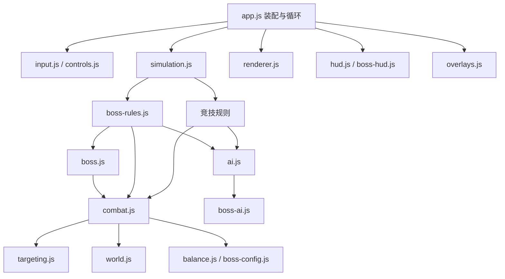

# 余烬试炼 · EMBERFALL 项目交接文档

> 交接日期：2026-10-19（Asia/Shanghai）。
> 本文最初基于首领首发提交 `5440ad1` 编写，已补充后续修复。当前发布版本以 [VALIDATION.md](VALIDATION.md) 中最近的成功部署记录为准。
> 文档提交与游戏发布提交可能不同。继续开发前先核对实际 HEAD、工作区状态和发布记录，不要将首发基准当作当前版本。

需求为什么这样演进、哪些方案试过但没有采用，请结合[游戏迭代历程与开发复盘](EVOLUTION.md)阅读；该文档与本交接文档分别记录历史过程和当前实现。

2026-10-19后续源码修复：坚韧计时、基线闸门、首领观战和庭院小地图，详见[四项问题修复记录](FIXES-20261019.md)及[迭代历程第16.3节](EVOLUTION.md#163-全项目检查后的四项修复2026-10-19)。其中坚韧修复有意更新竞技状态基线；本轮交付范围为GitHub源码同步，Sites没有随本轮更新。下文第14节仍保留此前已发布版本的历史验收。

同日后续体验调整：首领模式全部经验获取提高至原来的1.5倍，详见第4.2节与迭代历程第16.4节。2026-10-19 20:27（Asia/Shanghai）已将游戏源码 `2e4662a` 发布到[线上试玩站](https://emberfall-rogue-arena-1015.flowyaspen.chatgpt.site)，包含上述四项修复与经验加成；原网址及仅所有者访问权限保持不变。部署凭据见验证记录与迭代历程第16.5节。

2026-10-20审查后的八项修复覆盖过期选技卡、帮助与键盘、地刺冷却、火球出生碰撞、性能失败阈值、说明同步及晶体上限。当前竞技基线为8局3537标记，更新前已证明各局首个实质差异来自正确的地刺伤害；历史3492标记与旧首领矩阵仍保留为旧版本记录。详见 [八项修复](FIXES-20261020.md)，发布结果以验证记录为准。

2026-10-21源码修复：竞技观战名册保留节点与焦点，窄屏保留选人入口，小地图按显示尺寸等比绘制，攻击输入按指针归属释放；同时整理本文的历史与当前说明。详见 [本轮修复](FIXES-20261021.md)。包含修复与同步说明的 `94b0c3b` 已于北京时间10:58成功部署到原Sites站点，GitHub同步、保存版本与部署ID见 [验证记录](VALIDATION.md)。当前竞技基线仍为8局3537标记，原网址及仅所有者访问权限保持不变。

## 目录

2026-10-22后续修复：死亡等待输入在模拟步边界清理，HUD不再在复活后清掉新输入；技能卡方向键移动防滚页；首领AI与实际伤害共用最后有效步边界，并预测前摇期间撤离是否超出射程；静态菜单小地图复用缓存。新增真实浏览器入口与GitHub自动回归配置，verify自动发现单测。详见 [修复与验收](FIXES-20261022.md)。竞技基线仍为8局3537标记；新首领24局为22击败/2时限。游戏源码`1eec28b`已同步GitHub，并于2026-10-22 08:47成功部署到原Sites网址，保留仅所有者访问权限，详见 [验证记录](VALIDATION.md)。Actions配置因GitHub凭据缺少`workflow`权限，暂保存在`docs/ci/verify.yml`，尚未启用。

1. [接手速览](#1-接手速览)
2. [产品目标与范围](#2-产品目标与范围)
3. [三种玩法与操作](#3-三种玩法与操作)
4. [成长、经验与技能](#4-成长经验与技能)
5. [地图、资源与陷阱](#5-地图资源与陷阱)
6. [首领竞伤详细规则](#6-首领竞伤详细规则)
7. [代码结构与职责](#7-代码结构与职责)
8. [核心接口与数据约定](#8-核心接口与数据约定)
9. [主循环与界面流程](#9-主循环与界面流程)
10. [战斗、计分与碰撞](#10-战斗计分与碰撞)
11. [AI 行为与维护注意事项](#11-ai-行为与维护注意事项)
12. [数值修改入口](#12-数值修改入口)
13. [测试与验收](#13-测试与验收)
14. [首发历史验证结果（5440ad1）](#14-首发历史验证结果5440ad1)
15. [运行、GitHub 与 Sites 发布](#15-运行github-与-sites-发布)
16. [历史问题与防回归约束](#16-历史问题与防回归约束)
17. [已知限制与后续建议](#17-已知限制与后续建议)
18. [多人或子代理协作](#18-多人或子代理协作)
19. [接手检查单与后续任务模板](#19-接手检查单与后续任务模板)

## 1. 接手速览

### 1.1 项目标识

| 项目 | 当前值 |
| --- | --- |
| 中文名称 | 余烬试炼 |
| 英文名称 | EMBERFALL |
| 本地仓库 | `E:\workspace\ashfall-arena` |
| GitHub | <https://github.com/zlw0411-star/emberfall-arena> |
| 开发主分支 | `main` |
| 当前 GitHub 远程名 | `github`，不要默认认为是 `origin` |
| 当前发布版本 | 见 [最近的成功部署记录](VALIDATION.md)；`5440ad1`仅为历史首发基准 |
| 试玩站点 | <https://emberfall-rogue-arena-1015.flowyaspen.chatgpt.site> |
| Sites 项目 ID | `appgprj_6ad0c31508c0819192df1f0d79c32a01` |
| Sites 配置 | [`.openai/hosting.json`](../.openai/hosting.json) |
| 静态发布目录 | `dist/` |
| 本地启动 | `npm start`，访问 <http://127.0.0.1:4173> |
| 技术栈 | 原生 JavaScript ES Modules、Canvas 2D、HTML、CSS |
| 依赖 | 无第三方运行或测试依赖，Node.js 22 或更新版本 |

本次编写时实际检查到的本机运行时为Node.js `v24.18.0`；Node22是项目声明的运行目标，不表示本次另外进行了一轮Node22全量测试。

GitHub 源码仓库为公开仓库；最近一次发布时，Sites 为仅所有者可访问的站点。**源码公开与试玩访问权限是两件事**。交接后若需要确认当前访问范围，应读取 Sites 的实际访问配置，不能凭站点 URL 推断已经公开。

### 1.2 建议接手顺序

1. 查看 `git status`、`git log`、本文件和 [README](../README.md)。
2. 启动本地服务，实际查看三个入口和四张地图。
3. 阅读 `simulation.js`、`boss-rules.js`、`targeting.js`、`combat.js`。
4. 阅读 `app.js`、`overlays.js`、`hud.js`，理解前后端层次边界。
5. 查看 [验证记录](VALIDATION.md) 和 [首领逐局数据](boss-simulation-20261019.json)。
6. 按拟修改范围运行测试；涉及发布时执行完整回归及相关整局模拟。

交接文档、源码、验证结果发生冲突时，先核对该版本实际实现及测试，不要直接照搬早期聊天中的数值。旧版 `CONTRACT.md` 含有历史说明，部分段落描述的是早期技能池或仅竞技模式的行为。

## 2. 产品目标与范围

这是电脑浏览器可玩的俯视角像素肉鸽游戏。一名玩家与十一名 AI 同场发育，每局重新收集经验并随机选择技能，靠不同构筑和走位完成对局目标。

当前已完成：

- 经典远程生存竞技。
- 近战刀战生存竞技。
- 近战、远程混合的首领竞伤。
- 四张主题地图，以及首领模式的专用中央战场布局。
- 15 级成长、八个选技节点、两个独立的 13 项技能池。
- 中文菜单、操作指南、暂停、观战、重开、返回菜单及结算。
- 自动回归、可复现种子、整局模拟、固定构筑输出与性能检查。
- Sites 试玩发布与 GitHub 源码同步。

当前未实现：真人联网、账号系统、服务端排行榜、跨局存档、局外永久成长、装备背包、手机触控，以及近战翻滚、格挡、弹反和体力系统。对手均为本地 AI；每台电脑独立运行自己的对局。

用户持续强调：随机成长和构筑是核心；选技能不能全局暂停；不要因加等级、加系统而让一局无限延长；新增模式应保留已有玩法；修改后先验证，再同步交付。

## 3. 三种玩法与操作

### 3.1 规则对照

| 规则 | 经典远程 | 近战刀战 | 首领竞伤 |
| --- | --- | --- | --- |
| 角色组成 | 玩家＋11 AI，统一远程 | 玩家＋11 AI，统一近战 | 玩家＋11 AI，固定 6 远程＋6 近战 |
| 玩家普通攻击 | 自动攻击有效范围内最近目标 | 鼠标瞄准，左键点击或按住连斩 | 依玩家所选武器 |
| 旅者互伤 | 前 90 秒禁止，之后开放 | 同左 | 全程禁止 |
| 公告 | 第 80 秒起提前 10 秒提示互伤 | 同左 | 第 85 秒提示首领即将降临 |
| 任意角色满 15 级 | 进入决战，停止新怪与地图晶体刷新 | 同左 | 不改变刷怪、资源或胜负规则 |
| 决战 | 随机固定圆心，预警 10 秒后缩圈 180 秒 | 同左 | 不缩圈 |
| 死亡 | 本局淘汰，可观战或重开 | 同左 | 8 秒复活，构筑与分数保留 |
| 获胜条件 | 最后一名存活者 | 最后一名存活者 | 对首领实际累计伤害最高 |
| 平局 | 同帧全灭等情况 | 同左 | 最高分相同者并列；全员零分无冠军 |
| 时限 | 最长 720 秒 | 最长 720 秒 | 最长 600 秒 |

竞技模式通常目标为 5–10 分钟，但允许较早决出胜者，不强行延长已结束的对局。到 520 秒仍未进入决战，会自动开启同样的风暴流程；720 秒仍有多人时，最终风暴覆盖全图并处理同时淘汰。已经只剩一人时保留该胜者。

### 3.2 操作和流程

- `WASD`／方向键移动，斜向输入会归一化。
- 鼠标提供瞄准方向；近战左键点击挥刀，按住连续攻击。
- `Q / E / R` 按主动技能学习顺序施放。
- 鼠标点卡或数字 `1 / 2 / 3` 选择技能。
- `Esc` 手动暂停；失焦、切换标签页也会暂停。
- 技能选择期间战斗、陷阱、冷却、升级和阶段倒计时继续运行。
- 技能卡点击只用于选技，不触发一刀额外普攻。
- 鼠标松开、失焦、暂停、死亡、重开和返回菜单应清理攻击输入。
- 重开保留本局玩法、玩家武器和地图选项，使用新种子生成新局。
- 选择随机地图时，重开会按新种子重新抽图。
- 死亡后可用试炼者名册选择观战对象；聚焦角色行后用 `Enter / 空格` 选择。窄窗口保留双列名册，刷新保留焦点；目标死亡或结算后撤销交互并将焦点移回战场。
- 刷新页面默认回到经典远程和失落庭院。

## 4. 成长、经验与技能

### 4.1 成长参数

来源：`combat.js` 中的 `PROGRESSION`、`COMBAT_BALANCE`，以及 `balance.js`。

| 参数 | 当前值 |
| --- | --- |
| 最高等级 | 15 |
| 选技等级 | 2、4、6、8、10、12、14、15 |
| 一局可用选技次数 | 到达满级共 8 次，不是每级选一次 |
| 每次选择 | 随机三选一，无选择时限 |
| 同时装备主动上限 | 3 个 |
| 初始生命／基础攻击 | 280／13 |
| 每次升级 | 最大生命＋8、当前生命恢复 8、基础攻击＋0.4 |
| 15 级无被动基础值 | 最大生命 392，攻击 18.6 |
| 基础移速／拾取半径 | 100／30 世界像素 |
| 经验阈值 | `round((65 + (当前等级 - 1) * 12) * 1.1)` |
| 1→15 累计升级经验 | 2204 |

技能可以重复选择强化，已满级条目不再出现在选项中。已装备三个主动后，不再学习第四种主动，但可强化已有主动。跨越多个选技节点时，`pendingChoices` 排队，依次选择。

竞技死亡会清除本局待选队列。首领模式死亡则先保存队列和当前三张卡，复活后原样恢复，不能利用死亡重抽。

### 4.2 经验和治疗来源

| 来源 | 当前规则 |
| --- | --- |
| 地图经验晶体 | 竞技每颗 5 经验；首领模式 7.5 |
| 史莱姆／蝙蝠 | 竞技总经验 15，首领模式 22.5；角色击杀时 35% 直接发放、65% 掉落晶体 |
| 巨兽 | 竞技总经验 25，首领模式 37.5；同样采用直接经验与晶体拆分 |
| 击败旅者 | 竞技模式致命击奖励 `40 + 被击败者等级 * 5`，只在真正的存活→死亡转换时发放 |
| 治疗晶体 | 恢复生命，数值 40；不是经验晶体 |
| 首领参战 | 登场后每 10 秒检查一次，窗口内有效伤害且结算时存活者获得 6 经验（基础4×1.5） |
| 首领尾刀 | 无额外经验、无额外分数、无击杀回血 |

当前巨兽额外掉治疗晶体的概率以 `BRUTE_HEAL_DROP_CHANCE` 为准，代码中为 0.28。不要照用历史说明中的旧概率。

首领模式全部经验通过 `addXp` 统一乘 `BOSS_CONFIG.xpMultiplier=1.5`，玩家与AI、首领登场前后均生效。掉落物保留基础经验值，拾取时只乘一次；小数经验保留，经验飘字显示加成后的值。治疗量与升级阈值不受经验倍率影响。

### 4.3 两个独立技能池

每个武器池为 **5 主动＋8 被动＝13 项**。首领模式按每个角色的 `combatMode` 取池，不能让整局都读玩家的武器池。

主动技能均最高 4 级：

| 武器池 | ID | 中文名 | 基础效果／1→4 级变化 |
| --- | --- | --- | --- |
| 远程 | `fireball` | 火球 | 投射物与爆炸；基础伤害 36→63，爆炸半径 56→80；等级影响冷却 |
| 远程 | `dash` | 震荡冲刺 | 位移 112→148，冲击伤害 31→55，冲击半径 47→62 |
| 远程 | `quake` | 震荡波 | 周身伤害 29→56，半径 103→154 |
| 远程 | `chainLightning` | 闪电链 | 前向优先索敌，首击 30→48，共 3→4 目标，跳距 145，每跳保留 75% 伤害 |
| 远程 | `frostNova` | 冰霜新星 | 半径 125→155，伤害 22→37，减速 35%，持续 2→2.75 秒 |
| 近战 | `lunge` | 突进斩 | 位移 112→148，近身斩击 2.8→3.7 倍基础攻击 |
| 近战 | `whirlwind` | 旋风斩 | 周身半径 78→96，3→3.9 倍基础攻击 |
| 近战 | `heavySlash` | 重斩 | 前摇 0.35 秒，范围 96→114，3.5→4.7 倍基础攻击，并击退 |
| 近战 | `piercingThrust` | 穿云刺 | 前摇 0.22 秒，30°、范围 140→170，2.6→3.2 倍基础攻击 |
| 近战 | `bladeWard` | 护体刀阵 | 护盾 36→72，持续 3.5→4.25 秒，重复施放刷新而非叠加 |

表中伤害是基础效果；强化、暴击、竞技旅者减伤和首领独立倍率会进一步影响实际扣血。远程主动使用 `focusCooldown(skillCooldown(id, rank), focusRank)`；近战主动使用 `focusCooldown(def.cooldown, focusRank)`，技能强化本身不缩短近战主动冷却。无专注时，突进斩／旋风斩／重斩／穿云刺／护体刀阵的冷却分别为7／8／8／6.5／10秒。HUD与现有回归使用相同分流；不要把远程等级公式套到近战，也不要忽略专注减冷却。

被动技能均最高 5 级：

| ID | 名称／适用 | 当前作用 |
| --- | --- | --- |
| `power` | 强力弹丸／刀锋强化，两池共用 ID | 每级所有攻击伤害＋10%，最高＋50% |
| `haste` | 迅捷，两池 | 每级移速＋8%，普攻间隔缩短 6.5%；受间隔下限约束 |
| `vitality` | 坚韧，两池 | 每级生命上限＋30并恢复30，获得／强化定时回复 |
| `magnet` | 拾荒者，两池 | 每级拾取半径＋18，从30到120 |
| `precision` | 弱点洞察，两池 | 每级暴击率＋5%，最高25%，暴击为1.5倍 |
| `sustain` | 战斗续航，两池 | 每级击杀回血3，最高15，不超过生命上限 |
| `focus` | 灵能专注，两池 | 每级主动实际冷却缩短4%，最高20% |
| `multishot` | 连射，仅远程 | 每级间隔缩短5.5%、弹速＋18；4级起额外一枚弹丸 |
| `bladeReach` | 刀势延伸，仅近战 | 每级普攻刀长＋4、角度＋6° |

近战普攻基准：范围 68、120° 扇形、周期 0.65 秒、前摇 0.20 秒、有效判定 0.08 秒，伤害为基础攻击的 2.2 倍。方向在起手时锁定，挥刀可以移动，一刀可命中多人，但同目标每刀最多一次。

主动可打断未生效的普通挥刀；主动动作之间不互相打断。三种早期刀技的画面余效已延长，**余效时间不等于伤害窗口或动作锁时间**。

## 5. 地图、资源与陷阱

### 5.1 地图登记

| `mapId` | 名称 | 主要视觉与布局 |
| --- | --- | --- |
| `courtyard` | 失落庭院 | 断墙、岩石、石板庭院 |
| `desert` | 灰烬荒漠 | 沙地、风蚀岩群、争夺掩体 |
| `frost` | 冰封遗迹 | 长冰墙、转角、破碎冰原 |
| `swamp` | 幽暗沼泽 | 树根、分叉路径、岛状落脚区域 |
| `random` | 随机选择 | 在上述四种中按独立种子流抽取，不是第五种地形 |

世界尺寸为 2048×2048 世界像素，基础地块尺寸 32。角色通常半径 12。障碍是实体矩形，阻挡移动与普通投射物；移动和位移通过 `moveEntity` 做分步碰撞。

陷阱模拟类型主要为 `mud` 和 `spike`：泥地降低移动速度；地刺按4秒周期运行，阶段2.1秒起预警、2.8秒起生效。四种主题会换名字、颜色和画法，不等于每张地图各有一套不同的数值系统。

### 5.2 刷新参数

参数集中在 `simulation.js / CONFIG`：

- 初始晶体86、初始怪物29。
- 活怪上限62，地图晶体补给以当前晶体总数132为容量边界。
- 约每2.667秒尝试刷3只怪；约每5.833秒最多补5颗地图晶体，每颗生成前都检查剩余容量，批次内达到132立即停止。
- 怪物战利品不受地图补给容量限制，可使晶体总数暂时超过132；此时停止补地图晶体，直到总数回落。
- 竞技决战停止新增怪物与地图晶体，但保留已有资源。
- 首领模式持续刷新，并将新资源位置放在外围合法区域。

### 5.3 首领专用布局

`boss-map.js` 在主题地图基础上生成独立布局：

- 中央半径440无实体障碍、无环境陷阱。
- 十二个出生点在距中心640的圆周上均匀分布。
- 出生点周围清理安全空间，打通外围至中央的路线。
- 资源候选点通过可达地面检查，再筛选为外围点。
- `map.layout = 'boss'`，地图种子缓存键带首领布局标记。
- 首领本体通过 `map.movementCircles` 加入动态移动碰撞。

不要只换贴图就声称新增一种地图机制。新增主题需要同时检查几何、连通、出生点、资源、陷阱、地图预览和小地图缓存。

## 6. 首领竞伤详细规则

### 6.1 时间轴与成长

1. 0–90秒：打怪、拾经验，旅者始终不能互伤。
2. 85秒：全场公告首领即将登场。
3. 90秒：中央生成余烬巨像；若有实体与本体重叠，将其移到本体外。
4. 100秒起：每10秒结算一次6点参战经验，未参与者或结算时仍死亡者不获得。
5. 首领死亡或600秒：按累计实际首领伤害结算。

参战资格覆盖整个窗口。若角色在窗口内造成有效伤害，随后死亡并在该窗口结算前复活，仍可获得经验；不能在死亡时直接清掉该窗口资格。下一窗口会重置资格，不允许靠旧伤害重复领经验。

满15级不会停止刷怪、停止晶体或触发风暴。首领死亡不发放怪物经验、额外尾刀分或击杀回血。

### 6.2 首领属性与攻击

| 项目 | 当前值 |
| --- | --- |
| 初始生命 | 180,000 |
| 身体半径 | 64 |
| 位置 | 地图中央，固定不追人 |
| 阶段切换 | 生命不高于66%进入二阶段，不高于33%进入三阶段 |
| 阶段伤害倍率 | 1／1.15／1.3 |
| 阶段节奏系数 | 1／0.85／0.7 |
| 单招有效窗口／收招 | 0.15秒／0.6秒 |

三种招式按固定顺序循环，目标从本局种子随机流中选择：

| 招式 | 判定 | 基础伤害 | 预警 |
| --- | --- | --- | --- |
| `sweep` 扇形横扫 | 正面160°，半径200，方向锁定 | 45 | 固定1.35秒，各阶段不再压缩 |
| `rocks` 定点落石 | 最多3名不同角色脚下锁定区域，半径64 | 40 | `max(0.65, 1.1 * 阶段节奏系数)` |
| `cross` 十字震地 | 四条宽80、长480的区域，正交／斜向交替 | 38 | 同落石 |

一个招式对同一角色最多命中一次。首领不受减速和击退，但相关技能仍能造成伤害；本体阻挡走路、冲刺和突进，不阻挡武器射线对它自身的命中。

横扫最早方案是0.9秒，后来已调整为1.35秒。不要从旧计划把它改回0.9秒：基础移速的近战需要足够撤离时间，已有针对三阶段和30/60Hz的真实移动回归。

### 6.3 近身护佑

最新用户要求已实现：**距离首领中心不超过160世界像素时，旅者受到的首领伤害降低20%**。

- 近战、远程及AI均可获得，不按武器排除。
- 是角色中心到首领中心的距离，包含160这一边界；不是从首领身体边缘开始量。
- 距离在受击结算时判断，离开即失效，不是进入后持续数秒的增益。
- 仅在首领局、首领和角色都存活时生效。
- 当前来源判定要求 `source === game.boss`，不是任意带 `isBoss` 字段的副本。
- 小怪、陷阱、风暴伤害不减少；已有竞技模式不改变。
- 先减伤，再消耗护盾，最后扣生命。
- 例如基础45伤害，圈内为36；有20护盾则扣20盾、16生命。
- 地面淡绿色虚线显示范围；首领血条下显示当前是否生效。减伤不等于无敌，仍需要躲招。

配置与共享判断在 `boss-config.js`。修改范围或减伤比例，应修改同一份常量，让战斗、画面和HUD一起更新。

### 6.4 独立输出平衡

| 对首领的实际伤害系数 | 远程 | 近战 |
| --- | ---: | ---: |
| 普通攻击 | 2.0 | 1.0 |
| 主动技能 | 0.95 | 1.0 |

这些系数在首领实际受击时生效，并非排行榜偷偷加权。对小怪及原竞技模式不套用。近战的普通刀击自身已有2.2倍基础攻击系数，该值与这里的首领系数是不同层次。

曾试验过近战输出＋15%和＋8%，**它们不是当前发布配置**。最终采用近身减伤，并调整远程对首领输出；接手时以 `boss-config.js` 为准。

### 6.5 计分与胜负

- 唯一正式竞伤分数为 `actor.bossDamage`。
- 每次计入分数为 `min(命中前剩余生命, 本次实际对首领伤害)`。
- 小怪伤害、溢出伤害、额外尾刀奖励不计分。
- 原主人死亡后，已发出的投射物仍可命中并归属原角色。
- 保留浮点精度累计；HUD显示整数，测试报告伤害显示两位小数。
- `bossRankings(game)` 给出累计伤害、武器、占比、死亡数与名次。
- 对最高分采用1e-6容差判定并列；全员没有有效得分时不产生冠军。
- 结算优先检查首领死亡，其次检查600秒时限。
- 全员同时死亡不结束比赛，继续等待复活。

`damageDealt` 和 `damage()` 的返回值不能直接用来替代竞伤分数，它们的统计口径并不保证与首领实际损血封顶一致。

### 6.6 死亡、复活与选项保留

死亡时保存 `respawnChoices = {pendingChoices, choices}`，隐藏当前卡片、清动作和攻击输入，记录死亡次数并设置 `respawnAt = game.time + 8`。

复活时：保留等级、经验、技能、技能等级、冷却、累计伤害；满血回到外围出生点；清护盾、减速、动作和AI临时路线状态；恢复原队列及原卡片；设置2秒重生保护。

技能冷却在死亡期间继续计算，但全局暂停仍冻结对局时间。保护期间可以移动，不能新发起攻击或技能。选技本身不暂停战场，死亡界面可以临时观战、重开或返回菜单。

## 7. 代码结构与职责

`dist/` 同时是实际网页源码和发布内容，**不是构建后可随意删除再生成的目录**。本项目没有另一个 `src/`、打包器或依赖安装步骤。

```text
ashfall-arena/
├─ dist/
│  ├─ index.html / style.css / boss.css
│  └─ js/
│     ├─ app.js / state.js / dom.js
│     ├─ input.js / controls.js / overlays.js
│     ├─ hud.js / boss-hud.js
│     ├─ simulation.js / boss-rules.js
│     ├─ combat.js / targeting.js
│     ├─ balance.js / modes.js / boss-config.js
│     ├─ world.js / biomes.js / boss-map.js
│     ├─ ai.js / boss-ai.js / boss.js
│     └─ renderer.js / terrain.js / melee-vfx.js
│        / skill-vfx.js / boss-renderer.js
├─ tests/                 单元、DOM、对砍、性能、整局与快照脚本
├─ tests/baselines/       纳入Git的状态基线
├─ docs/                 本文、验证记录、接口历史与逐局数据
├─ .openai/hosting.json  现有Sites项目与静态目录
├─ .local/               被Git忽略的临时日志和调试材料
├─ package.json
└─ server.mjs            本地静态预览服务
```

| 模块 | 主要职责／维护边界 |
| --- | --- |
| `app.js` | 装配依赖、固定步长循环、RAF、插值和HUD调度 |
| `state.js` | 菜单、输入、观战等界面会话状态；不是模拟规则的所有者 |
| `dom.js` | DOM查询、显隐、时间文本、音效和提示 |
| `controls.js` | 指针捕获、短点击／按住、释放与取消攻击 |
| `input.js` | 键盘、瞄准、攻击输入、失焦暂停 |
| `overlays.js` | 模式／地图／武器选择、开局、重开、暂停、选卡、菜单和观战流程 |
| `hud.js`／`boss-hud.js` | 基础HUD及首领血条、竞伤榜、复活与结算界面 |
| `simulation.js` | 公共入口、竞技规则、移动、资源刷新和竞技结算 |
| `boss-rules.js` | 首领局创建、出现时机、参战经验、复活、时限与排名结算 |
| `combat.js` | 技能池、成长、角色和怪物战斗、投射物、陷阱与统一伤害入口 |
| `targeting.js` | 武器读取、敌我判定、有效目标及能否行动 |
| `balance.js` | 通用数值、怪物定义、技能参数及中文描述派生函数；零依赖 |
| `modes.js` | 武器模式注册和近战普攻公共参数；零依赖 |
| `boss-config.js` | 首领独立数值、近身护佑共享判断 |
| `world.js` | 种子随机、地图生成、空间／射线与移动碰撞 |
| `biomes.js`／`terrain.js` | 地图登记与主题绘制 |
| `boss-map.js` | 首领专用中央净空、外围资源和连通布局 |
| `ai.js`／`boss-ai.js` | 竞技AI及按武器分流的首领AI |
| `boss.js` | 余烬巨像状态机、招式快照与命中几何 |
| `renderer.js` | 场景、角色、投射物、小地图、镜头与缓存 |
| `melee-vfx.js`／`skill-vfx.js`／`boss-renderer.js` | 纯展示效果，不改变战斗结果 |

主要调用关系：



不要因为逻辑分散在多个文件，就重新塞回 `app.js`。此前已出现过重构后漏接回调的问题，结构改动必须以真实入口和状态回归验证。

## 8. 核心接口与数据约定

### 8.1 模拟入口

```javascript
import { createGame, stepGame } from './dist/js/simulation.js';

const game = createGame('example-seed', {
  mode: 'melee',       // classic | melee：武器
  mapId: 'frost',      // courtyard | desert | frost | swamp | random
  ruleset: 'boss',     // boss；省略时沿用竞技规则
});

stepGame(game, 1 / 60, {
  mx: 0, my: 1,
  aimX: 1024, aimY: 1024,
  castSlot: -1,
  attackHeld: true,
  attackPressed: false,
});
```

`mode` 和 `ruleset` 不是同一概念。首领竞伤不是第三种统一武器，不要写成 `mode: 'boss'` 来替代 `ruleset: 'boss'`。

旧调用 `createGame(seed)` 仍是经典远程竞技。`game.mode` 是本局玩家武器，创建后不可写；菜单中的选择通过创建新局生效，不修改进行中的游戏。

全部时间按秒、坐标按世界像素计算。角色及投射物的 `prevX / prevY` 用于插值，瞬移、出生和复活应同步更新，避免画面从旧位置飞过来。

### 8.2 重要字段

| 对象 | 重要字段 |
| --- | --- |
| `game` | `seed, rng, map, mode, time, phase, actors, monsters, gems, bullets, effects, events, zone, result, paused` |
| 首领局附加 | `ruleset:'boss', boss, bossNoticeSent, nextParticipationAt` |
| 角色 | `id, isPlayer, alive, hp, maxHp, level, xp, attackDamage, speed, skills, activeSkills, cooldowns, pendingChoices, choices` |
| 首领局角色附加 | `combatMode, bossDamage, bossParticipated, deaths, respawnAt, invulnerableUntil, respawnChoices` |
| 近战动作 | `id, kind, angle, range, arc, elapsed, windup, active, recovery, hitIds, damage` |
| 首领招式 | `id, kind, startedAt, windup, active, recovery, angle, radius, arc, width, damage, hitIds, targets?` |
| 地图 | `width, height, tileSize, obstacles, traps, spawnPoints, freePoints, seed, biome?, movementCircles?` |
| 投射物 | `ownerId, x, y, vx, vy, radius, damage, ttl, kind` |

竞技阶段为 `grace / hunt / finale`；首领局使用 `grace / boss`，结果另外存在 `game.result`。旧竞技对象可能没有显式 `ruleset` 字段，要通过 `isBossGame` 等约定判断，别假设每局都有 `ruleset:'arena'`。

### 8.3 结算结果

竞技：

```javascript
{ winnerId: 'a3' /* 或 null 表示平局 */, time: 503.7 }
```

首领：

```javascript
{
  winnerId: 'a3',       // 仅唯一冠军时为ID，否则null
  winnerIds: ['a3'],    // 并列时多个，零分时空数组
  reason: 'timeLimit',  // 或 bossDefeated
  time: 600,
  ranking: [/* id, name, combatMode, damage, deaths, share, index, rank */]
}
```

首领结果界面必须看 `winnerIds`，不能把 `winnerId === null` 一律显示成竞技全灭平局。

### 8.4 常用函数

| 接口 | 用途／注意事项 |
| --- | --- |
| `getSkills(game, actor?)` | 首领AI必须传入角色；不传时默认按整局玩家武器 |
| `addXp / getChoices / chooseSkill` | 升级、队列和随机选项；`getChoices` 可以填充缓存，不是绝对只读 |
| `castSkill(game, actor, slot, aimX, aimY)` | 按角色武器施法，检查死亡、保护、冷却和动作限制 |
| `damage(game, target, amount, source, context?)` | 统一伤害入口；首领输出区分 `context.attackKind = basic | active` |
| `canTarget / combatTargets / canAct` | 统一敌我、目标及行动限制，新技能不要另写一套互伤规则 |
| `combatModeOf(game, actor)` | 优先角色自己的武器，再回落到整局武器 |
| `bossAttackContains(...)` | 首领招式几何，伤害与AI共用，padding用于目标半径 |
| `bossGuardActive / bossIncomingMultiplier` | 近身护佑与承伤系数 |
| `moveEntity / blocked / lineClear` | 实体移动、静态阻挡、射线检查，各自语义不能混淆 |

## 9. 主循环与界面流程

浏览器每帧由 `requestAnimationFrame` 调度绘制；模拟固定60Hz。每个浏览器帧最多补6步，单帧时间差封顶0.1秒，超预算余量被限制，防止后台恢复后长时间追帧。HUD约每100毫秒刷新一次。

因此：

- 渲染可跟随60／120／144Hz等显示刷新率，不要为了“高帧率”直接改变战斗时间步长。
- 无绘制模拟P95不是浏览器FPS。
- 后台限帧、失焦暂停和嵌入浏览器状态会影响观察到的FPS。
- 不同时间步长的碰撞和RNG消耗可能不同；同种子30Hz与60Hz不保证完全同局。

`app.js` 用注入的 `actions` 对象连接输入、浮层和HUD。必须包含 `clearInput: input.clearInput`。遗漏它曾导致死亡／结算界面报错，进而使后续帧不能正常继续。

菜单 `state.selectedMode / selectedRuleset / selectedMap` 只管理待选项。正式开局调用 `createGame`；返回菜单重新创建预览局；重开创建新种子。换地图／布局时应失效地形和小地图缓存。

界面状态、声音和提示属于前端层；战斗结果、随机数、伤害、计分和时间推进属于模拟层，不能在渲染器里补算。

## 10. 战斗、计分与碰撞

### 10.1 统一入口的处理顺序

`damage` 的主要流程是：检查存活和有效伤害 → 重生保护／互伤拦截 → 伤害来源分类 → 暴击和竞技角色伤害倍率 → 对首领输出倍率及实际损血封顶计分 → 近身护佑承伤减免 → 护盾吸收 → 生命扣除 → 死亡、经验、掉落及相关事件。

不同目标的分支意义不同：首领受击用输出系数；旅者被首领击中用近身减伤；不要把这两种倍率混成一个“分数加成”。

竞技旅者伤害系数目前争夺期为0.65、决战期为0.95，保护期角色互伤在前面直接拦截。不要把这些系数错误用于首领竞伤。

### 10.2 首领本体与地形

首领不是普通怪物列表里的移动小怪，它独立存在于 `game.boss`，仅在战斗目标枚举时加入。

`map.movementCircles` 只影响移动碰撞。不要把首领圆体塞进通用 `blocked / lineClear` 静态障碍判定，否则会连“射向首领自身”的弹丸和技能一起挡住。

近战一刀多目标通过动作独立ID及 `hitIds` 去重，首领一次招式同样用命中集合。普通投射物的墙体阻挡仍保留；首领模式友方旅者不应截住友方弹丸。

### 10.3 时间字段

`slowUntil`、`respawnAt`、`invulnerableUntil`、首领招式的 `startedAt` 是绝对游戏时间；`cooldowns`、`shieldT`、动作经过时间等按剩余或经过秒数维护。新增效果先确定是哪一种，不要把毫秒、秒、绝对时间和倒计时混用。

## 11. AI 行为与维护注意事项

`ai.js` 提供竞技寻路、抢资源、打怪、交战、撤退和进圈，使用48像素寻路网格和静态导航缓存。陷阱危险随时间检查，不能把活动陷阱状态永久缓存为静态地形。

首领局由 `thinkBoss` 分流：

- 首领未登场时复用竞技发育策略，但不引入PvP目标。
- 登场后近战接近刀距，远程保持射程，按各自技能几何施放。
- 识别锁定预警，选择尽量近且能走到的安全出口。
- 躲避移动时，近战仍可进行合法普攻和非位移施法，避免无谓停手。
- 有预警时避免突进回危险区；保护期不攻击、不施法。
- 生命低于35%时可短时找治疗，恢复／重试有时间预算。
- 阶段目标等级约为 `min(15, 1 + floor(time / 35))`；落后时每30秒周期最多安排约8秒追赶发育，避免永远在外围清怪。

重要历史修复：近战贴近首领时，真实突进会被身体碰撞夹停，仍可命中。AI曾要求“完整112像素位移都放得下”，导致学会突进也不放。现在用 `moveEntity` 在位置副本上预测真实端点，并做安全检查。不要恢复旧的全距离门槛，也不要绕开移动碰撞直接把角色传到首领里面。

AI和玩家共用战斗、技能、冷却、命中及成长；AI策略可以不同，不能通过直接改分、直接扣首领血或忽略动作锁来补偿表现。

## 12. 数值修改入口

| 想调整什么 | 先看哪里 | 联动检查 |
| --- | --- | --- |
| 等级上限／选技节点／角色成长 | `combat.js` | 队列、HUD、结算、满级触发规则、跨级测试 |
| 通用主动／被动技能数值 | `balance.js` | 派生描述、AI施放距离、冷却、视觉几何 |
| 普通刀击窗口／范围／倍率 | `modes.js / MELEE_BALANCE` | 输入、方向锁、碰撞、去重和对砍 |
| 怪物种类与数值 | `balance.js / MONSTERS` | 出生速度与回落速度分开、掉落、归因、渲染 |
| 竞技资源／时限／缩圈 | `simulation.js / CONFIG` | 双模式整局、地图、状态基线 |
| 首领生命／时限／复活／输出倍率／近身护佑 | `boss-config.js` | 实际伤害、HUD、画面、固定构筑与24局矩阵 |
| 首领招式、阶段节奏、预警 | `boss.js` | `bossAttackContains`、AI闪避、展示、基础移速逃离测试 |
| 首领复活／经验／排名 | `boss-rules.js` | 死亡队列、全员死亡、同分、窗口经验、600秒 |
| 首领场地净空／出生／外围资源 | `boss-map.js` | 可达性、陷阱清理、四地图、多种子 |
| 视觉持续时间 | `melee-vfx.js / skill-vfx.js / boss-renderer.js` | 不改伤害窗口，不写回游戏状态，Canvas恢复 |
| 页面流程／布局 | `overlays.js / hud.js / boss-hud.js / HTML / CSS` | 真实入口DOM、浏览器、重开与菜单清理 |

新增技能一般需要：数值与描述 → 技能目录 → 效果／形状／升级表 → 角色武器分流 → AI → 视觉 → 测试。不能把历史说明中“只改一个文件”的表述当作当前完整操作步骤。

## 13. 测试与验收

### 13.1 常用命令

以下命令均从仓库根目录运行：

```powershell
npm test
npm run verify

# 独立前端入口流程检查
node tests/dom-smoke.mjs

# 首领相关局部测试
node --test tests/boss.test.js tests/boss-guard.test.js tests/boss-dodge.test.js tests/boss-lunge-ai.test.js

# 首领固定构筑输出＋12人满怪压力检查
node tests/boss-duels.mjs

# 首领完整24局矩阵：默认已经固定60Hz
node tests/boss-simulate.mjs

# 首领单个场景，适合先定位问题
node tests/boss-simulate.mjs --maps=frost --modes=melee --seeds=boss-sim-101

# 竞技单局，显式指定浏览器同频率
$env:SIM_HZ = '60'
$env:GAME_MODE = 'melee'
$env:GAME_MAP = 'swamp'
node tests/simulate.js sim-101

# 清除临时环境设置，防止影响后续默认测试
Remove-Item Env:SIM_HZ, Env:GAME_MODE, Env:GAME_MAP -ErrorAction SilentlyContinue

# 检查旧状态基线，不写新基线
npm run snapshot:check
```

`tests/simulate.js` 未指定 `SIM_HZ` 时默认30Hz；首领矩阵脚本固定60Hz。不要把默认30Hz结果冒充浏览器60Hz回归。

### 13.2 verify 覆盖范围与边界

`npm run verify` 覆盖单元测试、竞技双武器各3局60Hz模拟、真实入口DOM、双武器对砍、首领固定构筑和混合压力、竞技性能，以及8局旧状态快照。

脚本分6组显示，当前汇总10项检查（9个子命令及1项状态快照比对）。**首领24局完整矩阵不包含在这个命令里，需要单独运行**。

`tests/verify.mjs` 使用显式测试文件清单。新增 `.test.js` 后，除了运行它本身，还应检查是否接入该清单，不能仅因 `npm test` 能发现就以为发布闸门也覆盖了。

### 13.3 状态基线约束

- 文件：`tests/baselines/state-baseline.json`。
- 场景：经典／近战×`sim-101/202/303/404`，共8局。
- 当前基线：3537个逐秒／终局状态标记；地刺修复更新的依据见[本轮修复记录](FIXES-20261020.md)。上一版3492标记保留在`98c9dd7`，原3476标记保留在`ab66ae0`。
- 排除的纯视觉字段为 `meleeVisuals / hitFlash / effects`；`Set` 转数组稳定序列化。
- 当前实现使用SHA-256计算后保留前16个十六进制字符作为标记，不是保存完整256位散列字符串。
- 不只比较胜者，还比较步数、结束时间和每个标记。
- 架构整理、纯视觉和独立首领改动，不应重建旧竞技基线来“消除失败”。
- 确实有意改变旧竞技行为时，先说明预期差异和证据，再更新基线及记录。`npm run snapshot:write` 是写入操作，不是常规排错命令。
- 当前verify和snapshot:check遇到缺失、空、不完整或格式错误的基线会直接失败，不再跳过。基线须包含两种武器×四个指定种子的全部8局。

### 13.4 重点测试文件

| 文件 | 覆盖重点 |
| --- | --- |
| `contracts.test.js` | 公共规则、成长、阶段、决战与结算 |
| `controls.test.js` | 短点击、按住、指针捕获、无关指针释放与取消、第二指针拒绝和输入清理 |
| `determinism.test.js` | 强制种子随机与复现 |
| `maps.test.js` | 地图登记、可达、出生与模式兼容 |
| `modes.test.js` | 注册、按模式分发与兼容 |
| `melee.test.js / melee-vfx.test.js` | 刀击几何、打断、墙体、动作与余效隔离 |
| `skills*.test.js / skill-ai.test.js / skill-vfx.test.js` | 技能池、新技能、AI距离与展示 |
| `boss.test.js` | 混合武器、互伤拦截、计分、复活、经验窗口与结算 |
| `boss-dodge.test.js` | 基础移速三阶段30/60Hz闪避、站定受伤对照和保护限制 |
| `boss-lunge-ai.test.js` | 贴身突进真实端点、合法施放与危险回冲拒绝 |
| `boss-guard.test.js` | 近身护佑边界、两武器／AI、三招、护盾、来源排除和计分隔离 |
| `regen.test.js` | 满血不积存、晚学技能、强化周期、复活重新计时、暂停与粗步长 |
| `state-snapshot.test.js` | 完整8场景、格式与哈希覆盖、缺失／空／损坏基线CLI拒绝 |
| `minimap.test.js` | 四地图实体障碍、图层与标记、Canvas状态及模拟无副作用；不同显示比例、地图居中、暂停尺寸失效和隐藏尺寸 |
| `dom-smoke.mjs` | 真实启动 `app.js`，检查后续RAF、菜单、死亡、观战、结算和重开，以及竞技名册跨刷新焦点、死亡／结算撤销交互和暂停时小地图重绘 |
| `boss-simulate.mjs` | 四图×双玩家武器×三种子的完整24局 |

### 13.5 浏览器验收清单

实际检查菜单与武器／地图锁定、开局与重开；近战短点击和按住；选卡期间继续运行；卡片点击不挥刀；Q/E/R；界外释放；暂停／失焦；死亡观战与复活；原选项恢复；近身护佑进出；首领预警；排行榜与结算；返回竞技后无首领UI残留。

DOM测试使用mock Canvas/DOM，不能替代真实画面检查。临时验收页可以快速通过真实模拟进入边界状态，但必须注明加速方式，不冒充自然完整对局，并在发布前从 `dist/` 移除。不要把 `__boss-qa.html` 一类工具页带入发布包。

## 14. 首发历史验证结果（5440ad1）

以下仅为 `5440ad1` 首发时的已完成记录。最近成功发布与后续本地修复的验证结果见 [VALIDATION.md](VALIDATION.md)，不能将下列首发数据当作当前版本指标。

### 14.1 回归和性能

- 166项单元测试通过。
- `npm run verify` 汇总9/9通过。
- 24组命名前端DOM场景通过。
- 原竞技8局、3476个状态标记与旧基线一致，未因首领功能重建基线。
- 首领12角色、62活怪、1800步压力测试：平均0.332ms／步、P95 0.621ms，目标低于8ms。
- 以上性能是无绘制模拟计算，不能宣传为用户浏览器的实际FPS。

30.02秒无首领反击、合法选技次数的固定构筑输出：

| 等级／选技次数 | 远程首领伤害 | 近战首领伤害 |
| --- | ---: | ---: |
| 1／0次 | 884.00 | 1315.60 |
| 8／4次 | 1940.09 | 2148.17 |
| 15／8次 | 2931.18 | 3448.44 |

这个基准用于检查输出量级和实际倍率，不证明所有随机高阶构筑都平衡。

### 14.2 首领24局

场景为四地图×两种玩家武器×三个种子，60Hz；为完全自动选技，模拟中把全部角色标记为AI。

| 指标 | 远程 | 近战 |
| --- | ---: | ---: |
| 获得冠军的局数 | 13 | 11 |
| 累计首领实际伤害 | 1,818,513.01 | 2,053,348.16 |
| 累计死亡次数 | 14 | 115 |

| 地图 | 远程冠军 | 近战冠军 |
| --- | ---: | ---: |
| 庭院 | 4 | 2 |
| 荒漠 | 2 | 4 |
| 冰封遗迹 | 5 | 1 |
| 幽暗沼泽 | 2 | 4 |

24局全部在600秒以时限结算，平均600秒，没有自然击败18万生命首领。首领死亡、并列、无人得分、尾刀封顶和死后投射物等分支由真实伤害单测及DOM场景覆盖；不能把它写成“24局都打死首领”。

每局在格式化前以1e-6容差检查计分守恒。公开JSON把伤害显示到两位小数，按显示值复算最多约0.005误差，不是引擎凭空增加分数。

13:11只说明这组AI样本的榜首分布接近，不意味着死亡体验、每张图、每种构筑或真人操作已完全公平。近战115次死亡与冰图5:1仍值得后续观察。

原始结果、配置、固定构筑和回归摘要见 [boss-simulation-20261019.json](boss-simulation-20261019.json)。

## 15. 运行、GitHub 与 Sites 发布

### 15.1 本地运行

```powershell
Set-Location E:\workspace\ashfall-arena
node --version
npm start
```

服务绑定 `127.0.0.1:4173`，从 `dist/` 提供静态内容，不是联网游戏服务器。不要直接双击HTML启动，也不要假设安装依赖或执行 `npm run build`；当前没有这些需求／脚本。

4173被占用时先确认监听进程归属。不要为腾端口结束其他项目的Node进程。修改预览端口要相应更新本地启动说明，生产静态站点不依赖这个预览服务。

### 15.2 GitHub 同步

```powershell
git status --short --branch
git remote -v
git rev-parse HEAD
git ls-remote github refs/heads/main
```

提交前检查用户未提交改动，明确只纳入本次工作。完成相应验证与记录后，正常提交并推送 `main`。不使用强制推送，也不通过重置工作区清除未知变更。

`git push github main` 只说明源码同步完成，**不代表 Sites 已经更新**。同样，Sites 发布成功也不自动证明GitHub主分支相同，需分别核对。

### 15.3 Sites 已有项目更新

接手环境若使用 Sites 工具，先读取当前可用的 Sites `SKILL.md` 并遵循其中工作流。当前机器安装位置曾为：

```text
E:\agent-data\codex\plugins\cache\openai-curated-remote\sites\1.0.0\skills\sites\SKILL.md
```

这不是可移植依赖路径；换机器或插件升级后应从技能目录重新定位。

推荐发布流程：

1. 读取现有 `.openai/hosting.json`，复用项目ID，不能另建一个同名站点代替更新。
2. 通过 Sites读取站点，确认实际访问范围及所有者。
3. 创建本次短期源码写凭据，使用技能提供的source helper打开／同步源码，保留完整返回结果。
4. 完成实现、适当检查、完整回归、必要的24局模拟与浏览器验收。
5. 删除所有临时验收页，保留正式验证记录，检查 `git diff --check`。
6. 使用source helper完成Git准备、源码推送与打包；纯静态项目已完成全部检查后可用 `commands: []`，不能将未跑的检查当作“已完成”。
7. 核对GitHub `main`与本次提交；将helper返回的项目ID、提交SHA、原封不动的archive传给 Sites保存／部署。
8. 站点仍为确认的仅所有者可访问时，使用私有发布能力；其他实际受众按工具支持选择，不能擅自公开。
9. 仅在部署结果非终态时查询进度；`succeeded`后停止轮询并记录URL。
10. 打开正式URL交付，停止自己创建的预览服务，确认工作区状态。

Windows portable环境先前使用过：

```powershell
$env:PATH = 'C:\Program Files\Git\bin;' + $env:PATH
$env:TAR_OPTIONS = '--force-local'
# 再按当前Sites技能启动 site-workflow.mjs，等待隐藏stdin输入提示。
```

helper输入是JSON对象，包含 `credential`、完整的 `source` 打开结果、剩余 `commands` 和绝对 `archivePath`。凭据只保留在当前会话内存，并通过隐藏标准输入传入；**不写入文件、命令行参数、文档、Git、日志或公开链接**。过期后重新申请，不能复用旧会话中的失效token。

不要手工拼造Sites版本ID／部署ID；以工具实际返回的值为准。GitHub仓库和Sites源码存储是两个同步目标，也不要将源码Git地址误当作试玩URL。

### 15.4 发布记录与回退

当前游戏逻辑发布提交与Sites成功状态以 [VALIDATION.md](VALIDATION.md) 最近的成功部署记录为准。每次发布均记录提交、实际配置、测试结果、站点URL与部署状态；GitHub文档HEAD可能比线上游戏提交更新。

回退优先选择已核实的旧保存版本部署，或用正常Git revert形成可审查的回退提交，再重新验证、打包和发布。不要用 `reset --hard`、强推或覆盖用户工作区代替交接后的排错。

纯文档更新通常不需要重新部署游戏站点；若只更新GitHub文档，必须区分“文档HEAD”与“当前线上游戏逻辑提交”。

## 16. 历史问题与防回归约束

| 历史问题 | 当前处理 | 接手时避免 |
| --- | --- | --- |
| 重构后HUD漏接 `clearInput` | 入口装配完整actions，真实死亡／结算流程测试 | 只测试模块导入而不走真实入口 |
| 近战输入集合在模块导入时固定 | 输入按当前注册模式动态判断 | 把注册表派生结果永久缓存成旧集合 |
| 延长刀技画面误加伤害或锁定 | 展示事件与伤害窗口分开 | 用动画TTL驱动持续判伤 |
| 8人／15人／旧选技节点残留 | 当前固定12人、15级、八节点 | 从旧聊天恢复3/5/7/9或旧角色数量 |
| 首领混合武器读整局模式 | `combatModeOf`与逐角色技能池 | AI统一学玩家技能池 |
| 友方弹丸被旅者挡住 | 敌我判定用于目标枚举和伤害入口 | 仅扣血入口拦截，前面的碰撞仍吞弹 |
| 首领实体挡住射向自身的攻击 | 动态圆只进移动碰撞 | 把身体塞进静态射线障碍 |
| 近战横扫来不及步行躲避 | 固定1.35秒预警与真实移动测试 | 后期阶段继续压缩横扫预警 |
| AI贴脸不放突进 | 用真实碰撞预测夹停端点 | 用完整标称位移长度作为唯一条件 |
| 总伤接近但榜首长期偏向一类武器 | 同时看冠军、输出、死亡和地图分布 | 只用静止对砍或全队总伤判断平衡 |
| 死亡重抽选项 | 保存并恢复原队列和三张卡 | 复活重新调用随机抽卡替代恢复 |
| 死亡清掉整个窗口参战资格 | 到窗口边界统一重置 | 忽略结算前已复活的贡献者 |
| 重建基线掩盖回归 | 检查首个差异，记录有意玩法改变 | 为绿灯直接运行snapshot:write |
| 临时页面混入发布 | 发布前移除 `dist/__boss-qa.html` | 以为放在dist里也会被忽略 |

## 17. 已知限制与后续建议

### 17.1 已知限制

1. 当前是单机玩家＋AI，没有真人匹配或服务端权威模拟。
2. 首领仍是一只余烬巨像，四主题共用招式与数值，不能宣传为四只不同首领。
3. 2026-10-20发布验证及10月21日修复前复查的固定24局均自然击败首领，平均572.52秒；这不代表真人自然击杀率已验证。下一轮调节奏应先区分血量、发育效率、攻击空隙与输出问题。
4. 最近同组样本远程8冠／7次死亡、近战16冠／92次死亡；近战死亡仍明显偏高，冠军分布不等于生存体验已平衡。
5. 最近同组冰图样本为远程1冠、近战5冠，与首发的5:1方向不同；每图仅6局，不能据此断言稳定胜率或按首发数据直接调数值。
6. 当前近身护佑按精确首领对象来源判断。未来增加首领弹丸、持续区域或召唤物时，必须明确来源归属，否则可能不触发减伤。
7. 当前状态快照主要保护旧竞技流程，不等于首领也拥有同样的全状态快照基线。
8. 浏览器手测和DOM自动测试各有边界，后台限帧／自动暂停不宜作为性能退化的唯一证据。
9. 项目有部分历史压缩代码及长期接口文档，继续重构要小步、保留行为证据。
10. 不能把本机缓存目录中的日志、截图、归档或过期凭据当作干净克隆的运行依赖。

### 17.2 后续建议，尚未实施

优先收集真实玩家数据：两种武器的输出时间、复活次数、发育时间、技能分布、首领自然击杀率和每张图表现。先调整可解释的少量参数，再做保留种子与新种子检查，避免只拟合本次24局。

需要更多肉鸽选择时，优先增加能改变输出方式、代价或路线的构筑交互，而非单纯增加模式卡数量。未来新增首领、团队玩法或真人联网应另立需求与技术方案，不能直接在现有本地排行榜上接一个接口就称为联机完成。

## 18. 多人或子代理协作

用户此前明确支持子代理，各司其职，数量由负责人判断。模型偏好：简单工作用GPT-6 Luna；较复杂实现用GPT-6.1 Sol；不使用旧代模型，只有特别困难且Sol无法处理时才考虑Astra。此偏好记录不代表模型已在新接手环境可用，应先核对实际工具能力。

建议分工：

| 负责人 | 文件边界示例 |
| --- | --- |
| 整合负责人 | simulation／boss-rules、菜单／输入／HUD、renderer入口、发布 |
| 战斗子任务 | combat、targeting、技能数值及聚焦测试 |
| 地图与首领子任务 | boss-map、boss、boss-ai及对应测试 |
| 验证子任务 | 独占的新测试／日志／报告，运行矩阵并报告问题 |

开始前冻结接口、字段、单位、来源判定和文件归属。共享工作区中不能让多个代理同时编辑 `combat.js`、`simulation.js`、HUD或测试入口清单。需要跨边界修改时先交给文件负责人协调。

负责人统一检查最终生产配置、验证记录和发布提交；代理的“完成”消息不能替代实际文件、退出码与最终版本复核。验证代理不得为了测试通过擅自改数值或重建基线。

## 19. 接手检查单与后续任务模板

### 19.1 开始前

- [ ] 核对仓库、分支、HEAD、远程和用户未提交改动。
- [ ] 确认本轮是改玩法、数值、视觉、结构还是仅文档。
- [ ] 区分武器 `mode` 与规则 `ruleset`。
- [ ] 查看当前配置，不恢复聊天中的过时试验数值。
- [ ] 确定是否需要子任务，并冻结文件归属。
- [ ] 涉及Sites源码更新时，先按技能打开已有项目并保留返回结果。

### 19.2 完成前

- [ ] 相关聚焦测试及发布回归通过。
- [ ] 没有通过重建旧基线掩盖非预期行为变化。
- [ ] 需要时完成首领24局、地图连通或固定构筑检查。
- [ ] 浏览器流程与画面验证完成，并注明未覆盖的限制。
- [ ] 记录实际最终参数、命令、结果和风险，不把调参中间结果写成发布结果。
- [ ] 移除临时发布目录页面，凭据不落盘，`git diff --check`通过。
- [ ] 源码推送和站点发布分别确认，提交与归档匹配。
- [ ] 交付正式URL／文档链接，清理自己创建的临时预览服务。

### 19.3 可复制给下一位开发者或AI的任务背景

```text
你接手的是余烬试炼 EMBERFALL，仓库E:\workspace\ashfall-arena，
GitHub zlw0411-star/emberfall-arena，主分支main。
请先读docs/HANDOFF.md、README.md和docs/VALIDATION.md，并核对实际HEAD及工作区。
当前线上逻辑提交请查VALIDATION.md最近的成功部署记录；后续HEAD若只是文档更新，不代表线上逻辑已经改变。

当前是原生Canvas2D＋JS模块，无第三方依赖，dist就是实际源码与静态发布目录。
12人、15级、2/4/6/8/10/12/14/15选技，最多3主动，选技不停战。
mode是classic/melee武器，ruleset:'boss'才是首领竞伤；旧竞技省略ruleset。
首领模式6远程6近战、90秒登场、600秒结算、8秒复活、2秒保护、
首领中心160像素内受到的首领伤害减20%，先减伤再扣盾，小怪陷阱不变。
正式分数只读bossDamage，统一damage入口计入实际首领损血，不能用隐藏计分倍率。
输出平衡参数只作用于首领：远程普攻2、主动0.95，近战均1。

架构、视觉或独立首领改动不应改变旧竞技8局状态快照；不能重建基线掩盖回归。
发布前按范围跑npm run verify，首领整局矩阵另跑node tests/boss-simulate.mjs。
当前竞技基线为8局3537标记，地刺修复的差异证据见docs/FIXES-20261020.md。
观战焦点、窄屏名册、小地图比例和多指针修复见docs/FIXES-20261021.md。
最新单测、DOM和浏览器结果请查docs/VALIDATION.md；本地源码状态与线上发布状态分别核对。
首领平衡以最新有明确版本与配置的完整矩阵为准，不将历史24局数据冒充本轮结果。
新增工作完成后按授权同步GitHub与现有Sites，保留站点原访问权限，凭据只走隐藏stdin。
修改前先说明本轮范围；需要协作时明确接口和文件归属，负责人统一整合与交付。
```
